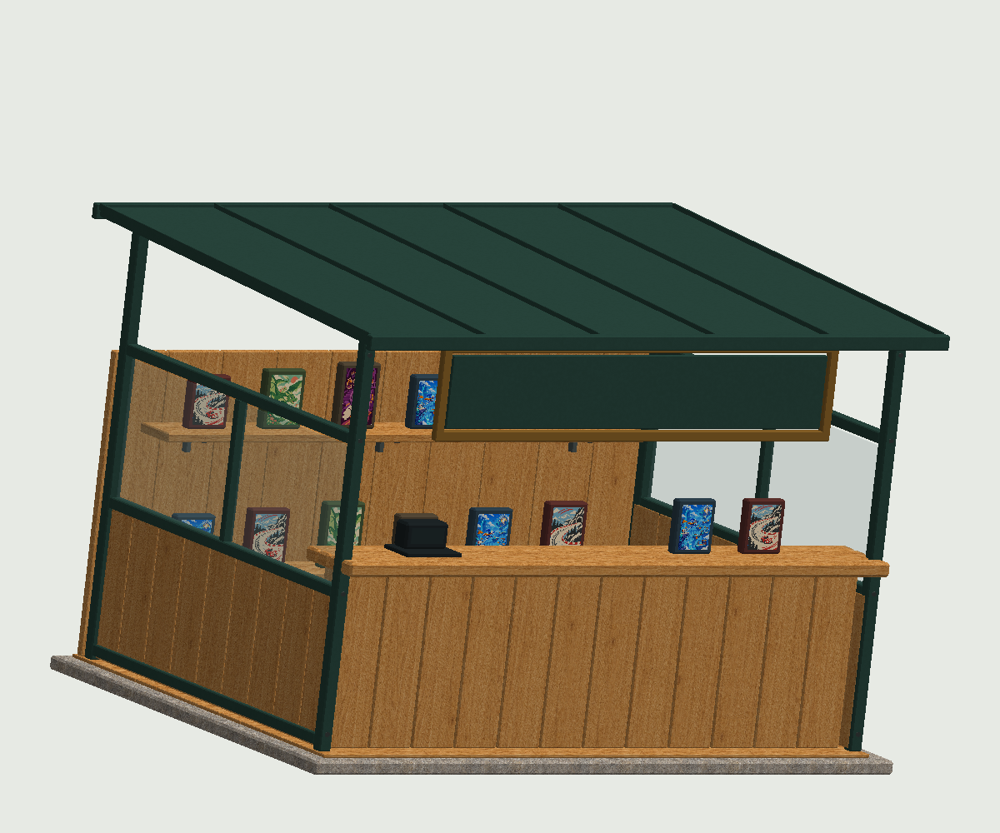
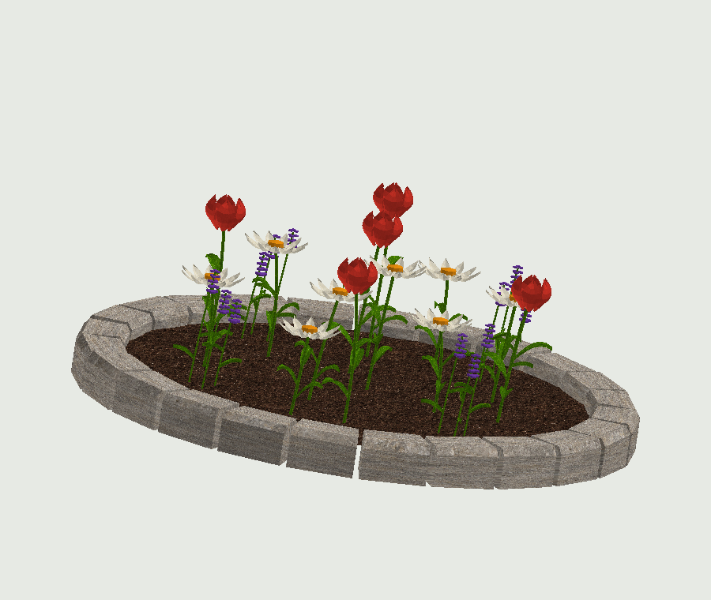
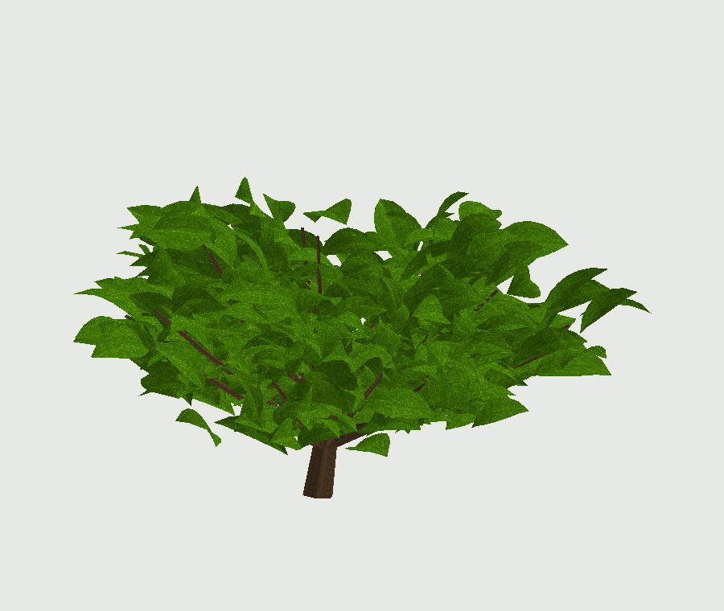
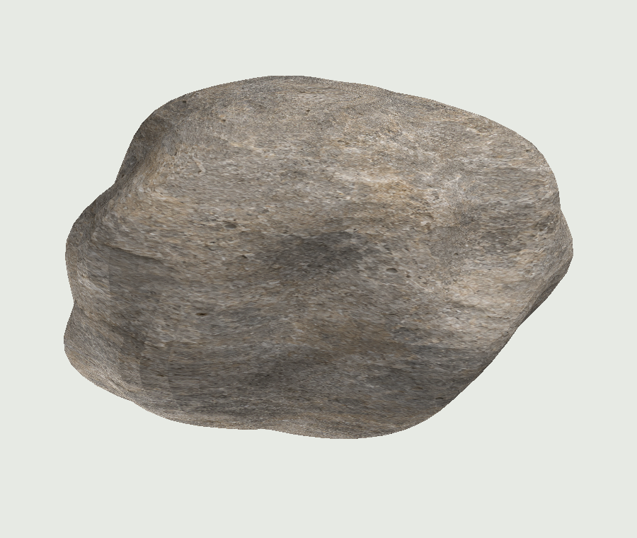

# Реалистичный парк и киоск — запрос владельца 07.11

Шесть оригинальных моделей: RockSmall, RockMedium, RockLarge, Bush, Flowerbed, Pawnshop. Импортируемый glTF 2.0 с UV и PBR-материалами, исходники сборки и превью реальной геометрии. Это замена простых фигур по новым скриншотам владельца, разрешающая mesh и текстуры для этой пачки.

## Передача Dev 1
Импортировать .gltf каждого объекта через Roblox 3D Importer с соседними .bin/PNG, сохранить и загрузить mesh/SurfaceAppearance. Сохранить имена корней, SignPanel и Counter у Pawnshop; лицевая сторона киоска +Z. Масштаб — studs, Y вверх, основание Y=0. Сохранить полученные модели в соответствующих шаблонах ServerStorage.Upgrades. Заменить также старые встроенные клумбы в Park. Один коммит файлов в Git не заменяет модели в опубликованном плейсе.

Сохранить взаимное расположение папок: часть материалов общая в textures. Настроить коллизии по назначению: киоск/камни — нужные опорные поверхности, листья/цветы/товары — без столкновений. Уточнить проход и взаимодействие ломбарда на сервере с двумя клиентами.

WorldService в этом PR скрывает только четыре старых элемента вывески Pawnshop, закрывавших текст, и добавляет отступ надписи. Переводы по TextKey сохранены; в новой геометрии вывеска намеренно пустая.

## Материалы
Карты поставляются 2048×2048. Пять AI-исходников имеют 1254×1254 и увеличены до 2048; это не нативная 2K-фотосъёмка. Normal/roughness выведены приближённо из цвета, не получены сканированием или запеканием high-poly. Исходники и промпты приложены; бесшовность на крупных поверхностях проверить при импорте.

## Превью

