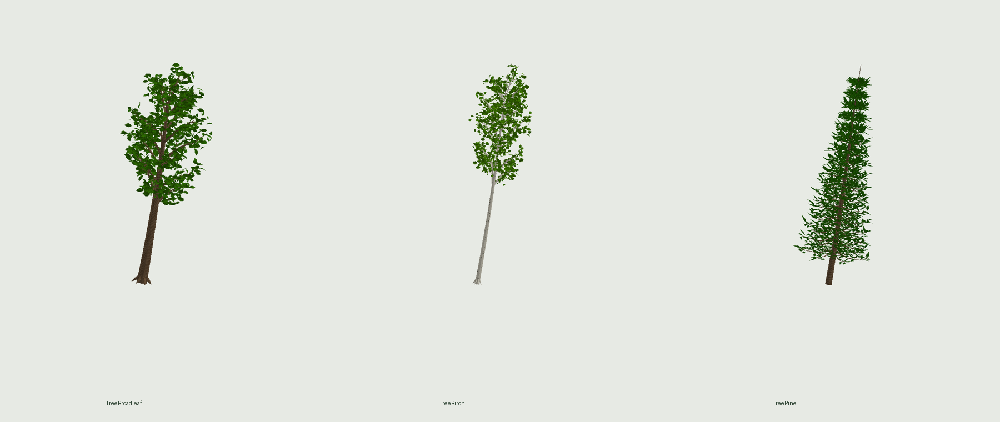

# Деревья парка — обновление по запросу владельца 07.11

Три оригинальные модели glTF 2.0 для замены шаров и прямоугольных ярусов в старом парке:

| Модель | Габариты X×Y×Z, studs | Треугольники | Mesh-узлы |
|---|---:|---:|---:|
| TreeBroadleaf | 7.4×16.6×7.4 | 20 904 | 4 |
| TreeBirch | 5.4×18.6×5.4 | 20 904 | 4 |
| TreePine | 6.2×18.2×6.2 | 24 928 | 4 |

Сужающиеся изогнутые стволы, ветвление, индивидуальные изогнутые листья и хвойные побеги, отдельная кора берёзы. Без сфер кроны, скриптов, источников света и alpha-карточек. Каждый mesh меньше 20 000 треугольников. Pivot в центре основания, Y=0 снизу, Y вверх. Крона может смыкаться с собственными ветками: это намеренная ботаническая сборка, не гарантия отсутствия любых геометрических контактов.

## Импорт для Dev 1
1. Открыть `TreeBroadleaf/TreeBroadleaf.gltf`, `TreeBirch/TreeBirch.gltf`, `TreePine/TreePine.gltf` через 3D Importer вместе с соседними PNG/.bin. Сохранить названия корней, масштаб в studs и материалы SurfaceAppearance. Загрузить mesh и карты в Roblox.
2. Заменить соответствующие шаблоны и экземпляры **внутри Park/LandscapeObstacles**: старые деревья уже встроены в эти модели. Замена только отдельного шаблона не обновит существующие копии. Сохранить позиции и вращения, не добавлять новые деревья на дорожки и в центр 16×16.
3. У листвы и мелких ветвей выключить CanCollide, CanTouch и CanQuery. При необходимости сделать один простой невидимый коллайдер ствола; подробная сетка веток не должна блокировать игрока и артефакты. Сохранить возможность подбирать артефакты рядом со стволом.
4. Проверить картинку с близкого расстояния и сверху, освещение игры, доступность дорожек, артефакты и FPS на телефоне. При большом числе копий сравнить с прежним парком до публикации.

Git-файлы сами не обновляют плейс. Загрузку asset IDs, материалы и результат в Studio здесь проверить невозможно. Оригинальные .rbxm остаются до принятия новых импортов.

## Текстуры и исходники
Карты 2048×2048: цвет, normal, ORM (R=AO, G=roughness, B=metallic). Кора сделана процедурно в исходном разрешении 2048²; normal приблизительный по цвету. Листва использует оригинальный AI-albedo из #319, исходник которого 1254² увеличен до 2048²; оттенки адаптированы, normal листвы плоский. Это не фотограмметрия и не нативный 2K-фотоскан. Нет скачанных сторонних материалов.

Все необходимые PNG рядом с glTF. `textures/` содержит исходники для повторной сборки, `build_trees.py` и `render_mesh.py` — воспроизводимые генератор и CPU-превью. Установить requirements.txt, затем `python3 build_trees.py`. Превью показывают именно геометрию и UV модели, не AI-концепт. Preview не включает normal map и не заменяет проверку SurfaceAppearance в Studio.

