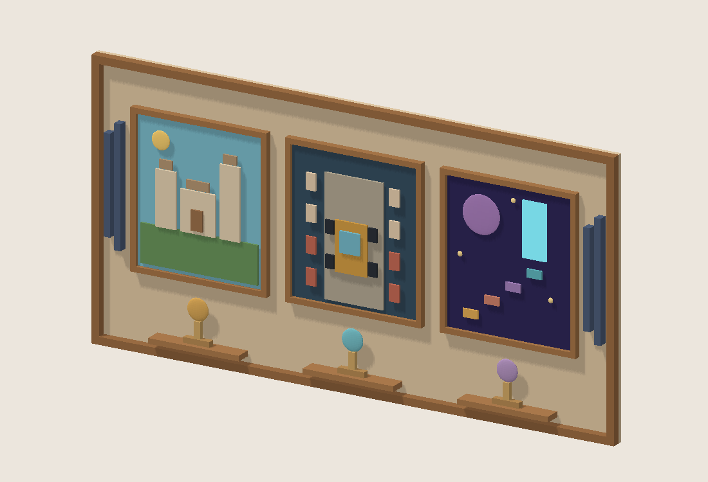
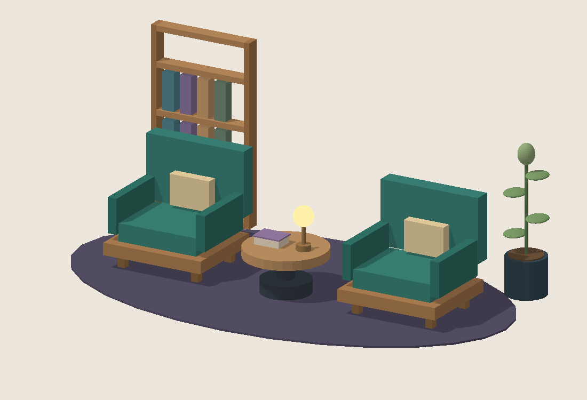

# V38-3 — галерея B и читальный уголок C

Нативные Roblox-модели по эскизам V36 #310, в пределах ≈100 деталей. Упрощение сцен под тонкую галерею и небольшой уголок: без новых оболочек, окон, города, потолка и пола здания. Все картины и книги без текста/цифр, рисунки сделаны собственными деталями, без внешних image/mesh IDs.

| Модель | Детали | X×Y×Z, studs | Локальный pivot в пределах этажа |
|---|---:|---:|---|
| GameGallery | 69 | 9.8×5×0.39 | (0, 3, −28.8), этаж 2 |
| PanoramaCorner | 56 | 9.6×3.92×5.6 | (22, .025, 8), этаж 3 |

Галерея: три игровые композиции (замок, гонка, космические ступени), награды и акустические вставки. Читальный уголок: два зелёных кресла, стол, книга/лампа, стеллаж и растение на ковре. По одному слабому PointLight без теней, остальное свечение — Neon. Никаких скриптов; кресла — декор, не дополнительная игровая механика сидения.

## Важное исправление положения B
Старая зона эскиза X −27…−17 закрывала бы **RearWindow** актуального Floor. Галерея перенесена на глухой **CentralWall**, X −4.9…4.9, Y 3…8, Z −28.995…−28.605. Существующие GrowthArt остаются позади без геометрического пересечения; при интеграции их можно отключить как заменяемый настенный декор. Стекло не закрывается.

Для C подъём .025 учитывает верх пола (.02) и FloorJoint (.024). Он нужен при размещении, а не запечён в модель. Зона C: X17.2…26.8, Z5.2…10.8. Правая панорама остаётся существующей; новых стёкол в пакете нет.

## Имена и интеграция Dev 2
В текущем Upgrades.luau нет отдельных заменяемых шаблонов B/C, поэтому для дополнений заданы **GameGallery** и **PanoramaCorner**. Не переименовывать их в Floor/Skyscraper и не перезаписывать оболочки. Lounge и ArtWall из #312 сохраняются. Подключение новых моделей, их зависимость от покупки этажа и возможные ключи конфигурации делает Dev 2; новых покупок/бонусов арт не задаёт.

## Импорт Dev 1
Импортировать по одному варианту из models: RBXM **или** RBXMX. Корни и названия сохранить, положить в ServerStorage.Upgrades после согласования подключения с Dev 2. Позиции из таблицы считаются от центра основания этажа; при этажах Y=14/28 получаются Y=17 и Y=28.025 относительно участка. Pivot самого файла — (0,0,0), центр основания, +Z вперёд. Не запекать глобальные высоты в шаблоны.

В source/*_baseline.rbxmx лежат только снимки текущих оболочек для проверки — **не импортировать** как новые этажи. В этих снимках могут быть прежние контакты/стыки: проверка гарантирует только отсутствие пересечений новых частей с ними.

Материалы V38-1 (#323) подключаются Dev 2 через MaterialVariant; эти модели остаются нативными и не содержат недействительных texture IDs. Сначала принять геометрию, затем настроить нужные материалы на дереве/металле/обивке по игровому стилю.

## Проверка и ограничения
VALIDATION.json и INDEPENDENT_VALIDATION.json: 2346 и 1540 пар деталей без объёмных пересечений, pivot, anchored, binary roundtrip и свет проверены. LAYOUT_VALIDATION.json: лифт/подход/кнопки свободны, новые части не пересекают текущие оболочки. Справочные позиции рабочих мест и apron проверены для 7 и 11 столов.

Это статическая проверка файлов, а не Studio-тест. В плейсе проверить актуальные изменённые расстановки, кнопки, свободный проход к креслам, свет, читаемость галереи, прозрачность окон и FPS. Стулья стоят лицом к +Z как шаблон; взгляд на правую панораму доступен сбоку, отдельной анимации поворота нет.

## Воспроизведение
Python + numpy/Pillow, Rojo. Выполнить source/build.py, source/check_layout.py, source/validate.py; путь к Rojo можно передать через ROJO для сборки (для проверки изменить локальный путь при необходимости). Превью строятся из реальных экспортируемых частей. Эскизы #310 являются художественными ориентирами, не точным снимком итоговой модели.

